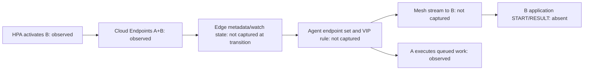

# KubeEdge cold-expansion carryover assessment

**Updated status:** the [direct-evidence addendum](#direct-evidence-addendum-cross-round-requests-and-comparison-v3) below establishes cross-round application-request contamination. It supersedes the earlier hypothesis-only framing and the proposed six-episode sensitivity. Earlier analysis is retained as the investigation history; the current plan replaces all 12 KubeEdge cells prospectively under one fresh-state procedure and preserves the old rows as diagnostics.

This is a read-only assessment of retained artifacts and pinned upstream source. It changes no frozen v2 source, outcome, protocol, core code, or running experiment. The 36-episode v2 matrix remains the primary reused-state experiment. The proposed six-episode sensitivity is additional work after that matrix, with its own frozen recipe and identifiers.

**Established finding:** in `f1-kubeedge-cold-online`, the healthy-cloud control activated a real B worker but delivered no measured application request to it. The artifacts locate a gap between cloud-side activation/endpoint publication and application-level use of B. They do **not** identify which watch, cache, interception rule, or tunnel failed. Retained EdgeMesh state across earlier partitions and EdgeCore restarts is a plausible explanation, not a proven root cause.

## Reconstructed outcomes

Counts below were reconstructed read-only with the existing analyzer and physically collected journals. Journal RESULT totals include retained drain after the offered window; they are not all successful client returns.

| Episode | Offers | Correct returns | Timely returns | A journal RESULT | B journal RESULT | B instance_ready on A clock |
|---|---:|---:|---:|---:|---:|---:|
| Cold-online calibration | 930 | 737 | 661 | 579 | 351 | 61.247s |
| Formal warm-drop, repeat 1 | 930 | 930 | 930 | 465 | 465 | Before offers |
| Formal warm-online, repeat 1 | 930 | 930 | 930 | 465 | 465 | Before offers |
| Formal cold-drop, repeat 1 | 930 | 125 | 94 | 547 | 0 | No B worker observed |
| Formal cold-online, repeat 1 | 930 | 127 | 94 | 552 | 0 | 72.820s |

The matched 20–110s offered-arrival cohort contains 570 offers. Its timely yield is 55/570 = **9.649%** for formal cold-online and 53/570 = **9.298%** for formal cold-drop. The difference is 0.351 percentage points in this pair. This floor-level similarity is not evidence that a C outage has no effect in a healthy fresh-state baseline. Calibration is descriptive, not a formal repeat; its repeat-zero marker correctly prevents treating it as a qualified formal row.

Evidence: [calibration](../protocol/calibration.json), [calibration journals and requests](../runs/pilot-ke-cold-online), [formal cold-online artifacts](../runs/f1-kubeedge-cold-online), [formal cold-drop artifacts](../runs/f1-kubeedge-cold-drop), and the corresponding [cold-online](../evidence/f1-kubeedge-cold-online/ke-end-inventory.json) and [cold-drop](../evidence/f1-kubeedge-cold-drop/ke-end-inventory.json) cloud inventories.

## What the observations establish

In formal cold-online, B's physical journal contains one `instance_ready` record and **zero START/RESULT records**. The final cloud inventory has B Running and Ready, both A/B in the Service Endpoints `addresses`, HPA current/desired replicas equal to two, and `ScalingActive=True` with `ValidMetricFound`. Therefore a failure to request or instantiate B is not an adequate explanation for that online episode.

By contrast, cold-drop ends with one replica, missing resource metrics, no observed B worker, and A in `notReadyAddresses`. These are different control states despite similar client yields. They must not be described as the same failure mechanism.

All 159 cloud probes and 159 peer probes succeeded in formal cold-online. These probes establish reachability of their specific health/clock endpoints, not the application mesh tunnel. Maximum driver scheduling delay was 0.860ms. The frozen driver requests `Connection: close`; the Service has `sessionAffinity: None`. Driver starvation and simple reuse of one long-lived HTTP connection are weak explanations.

A's retained cold-online kernel results have median service time approximately 208.23ms. One late retained request was offered at 102.625s, started the kernel at 156.228s, and completed at 156.435s. This directly shows substantial work waiting beyond the client's 2s timeout. The worker serializes execution and receives no request-cancellation context in its kernel call, so continued backend work after client timeout is expected from the shared implementation. It explains how 552 results can coexist with only 127 correct client returns; it does not establish why B was unused. See the [HTTP worker](../../cmd/revision-domain-worker/main.go) and [shared worker implementation](../../pkg/revisiondomainworkload/workload.go).

The same two EdgeMesh containers persisted across calibration and these formal episodes:

| Node | Mesh Pod UID | Container ID suffix | Restart count | Container start |
|---|---|---|---:|---|
| A | `95062d9d-dc36-4456-afb3-1906eab4081f` | `…a81677f9f3fb` | 0 | 13:59:05 UTC |
| B | `4fa55a39-6505-43ec-91ef-dd787b69bebd` | `…72a5ca5d9d5` | 0 | 13:59:04 UTC |

Their unchanged identities are direct evidence of process-state persistence. The [post-measurement cleanup policy](../evidence/postmeasurement-cleanup-policy.json) and [operator record](../evidence/postmeasurement-cleanup-operator.py.txt) restart owned EdgeCore services after completed measurements and deletion timeouts; they do not restart the Mesh agents. This assistance did not replay measured requests, but can change the administrative history inherited by later episodes.

Warm-online still achieved 465/465 execution attribution after earlier recovery activity. This rules out permanent global inability to execute on B. It does not prove that later dynamic endpoint updates worked: a prepopulated two-endpoint service and an A-only service that later expands exercise different state transitions. Reuse of the fixed VIP `10.96.50.90:34090` also leaves stale-interception hypotheses worth checking.

## Source-informed failure boundaries

The conceptual dependency chain is:

These arrows describe dependencies, not a captured causal trace.

EdgeMesh v1.17 registers Service/Endpoints informers and a userspace proxy. Its configured informer resync period is 15 minutes; that constant is not a promise that a missed update recovers within a 150s episode. [Official proxy setup](https://github.com/kubeedge/edgemesh/blob/v1.17.0/pkg/proxy/server.go).

An Endpoints update normally rebuilds the balancer's endpoint list and resets its round-robin index. Endpoint selection is followed by connection attempts; failed dials can cause another endpoint attempt. Consequently, zero B executions is compatible with either missing B in the effective balancer state or unsuccessful attempts to connect to B. [Official load balancer](https://github.com/kubeedge/edgemesh/blob/v1.17.0/pkg/loadbalancer/loadbalancer.go).

Endpoint conversion uses ready `addresses`, including node/IP/port information, rather than `notReadyAddresses`. A B Pod's Ready condition at C and a later correct cloud Endpoints object are therefore necessary evidence, but do not prove the A agent consumed that object at the needed time. [Official endpoint conversion](https://github.com/kubeedge/edgemesh/blob/v1.17.0/pkg/loadbalancer/util.go).

KubeEdge's MetaServer GET/List first tries the cloud and falls back to storage. A successful GET can also save the returned object locally. Thus the connected HTTP request called `edge-cache` is not a passive snapshot of prior persisted cache or agent informer contents. Extra in-window GET polling could itself alter the state being diagnosed. [Official REST storage](https://github.com/kubeedge/kubeedge/blob/v1.23.1/edge/pkg/metamanager/metaserver/kubernetes/storage/storage.go).

The watch agent has explicit reconnection synchronization. Its log message containing `failed to process watch apps` is emitted even when the returned failed-watch map is empty. The retained `map[]` log is not proof of unsuccessful synchronization. Those retained logs are from the earlier warm-drop cleanup period, not a direct cold-online transition trace. [Official watch agent](https://github.com/kubeedge/kubeedge/blob/v1.23.1/edge/pkg/metamanager/metaserver/agent/agent.go).

| Hypothesis | Support | Missing discriminating evidence |
|---|---|---|
| A's effective balancer never learned B | A-only start, cloud AB at end, B receives nothing; agent process persisted | A agent endpoint-update logs/effective endpoint set at B activation |
| Stale old-Service/VIP interception remained | VIP is reused; namespace deletion and EdgeCore recovery occurred | Actual image-backend NAT rules, listener/process ownership and Service identity during failure |
| A knew B but its mesh stream failed | B local service ready does not establish cross-node delivery | Dial/proxy-stream errors and peer/tunnel state tied to B's address |
| Persisted metadata/watch registration survived inconsistently | Reused DB, retained agent, restarts and prior disconnections | Filtered local DB resource versions and actual watch events, aligned with C's versions |
| A overload amplified a routing failure | Long offer-to-kernel delay and many client timeouts are observed | This consequence alone cannot explain why B received zero requests |

There is insufficient evidence to select one of the first four. DNS nameserver-limit warnings and an empty failed-watch map do not locate the defect. A later direct GET returning B is also insufficient because of its cloud-first behavior.

## Additional six-episode sensitivity

Run **after all original 36 episodes**, preserving every v2 row. Describe v2 as the reused-state condition, including its administrative recovery history. The original protocol did not require connected cold-expansion functional success before each measured episode; poor outcomes must not be retroactively discarded for failing a new criterion.

For one fixed followup recipe, the recommended estimand is a **fresh edge control/cache and routing-process state sensitivity**, using the same real EdgeMesh and standard HPA. Resetting only Mesh agents would be a narrower in-memory-routing experiment. Resetting EdgeCore and its DB plus Mesh agents tests a broader bundle; recovery would not identify which component was responsible. Choose one recipe before the six runs and do not escalate it based on early outcomes.

Suggested identifiers/order, to be frozen separately:

| Repeat | First episode | Second episode |
|---|---|---|
| 1 | `s1-ke-cold-online-fresh` | `s1-ke-cold-drop-fresh` |
| 2 | `s2-ke-cold-drop-fresh` | `s2-ke-cold-online-fresh` |
| 3 | `s3-ke-cold-online-fresh` | `s3-ke-cold-drop-fresh` |

Both conditions reset before **every** episode. Retain the 930 offered offsets, 150s window, 500ms deadline, 2s timeout, kernel/hash, application budgets, HPA configuration, native Service/mesh routing, and 20–110s fault schedule. C and its control components remain reused and C has no application worker. Use new namespaces and fresh attempt IDs; report followup results separately rather than substituting them into the v2 table or pooling their requests as extra repeats.

### One fixed reset recipe

The following is a proposed parent-operated procedure, not an action performed by this assessment.

1. **End the prior episode completely.** Retain its outcomes, journals and recovery records; verify its exact fault rules are absent, its original namespace deletion completed, and no application worker remains on A/B. Record the owned outer-container IDs/labels, old Mesh Pod UIDs, CRI container/sandbox IDs and process start identities.
2. **Stop EdgeCore before replacing Mesh Pods.** Stop only the owned A/B services, verify their writers have exited, and stop the exact old Mesh CRI containers/sandboxes whose labels match the recorded Pod UIDs. Then issue nonblocking, UID-preconditioned deletion of those Mesh Pods at C; zero grace is appropriate only after verifying the old containers stopped. Do not wait for an offline EdgeCore to acknowledge deletion before restarting it. The real DaemonSet may queue new desired Pods while the edge is stopped; do not manually place an application on B. Alternatively, a predeclared pause of only the owned DaemonSet can prevent recreation races, but do not mix procedures between runs.
3. **Archive only the configured SQLite state while stopped.** For each owned node, verify the configured datasource resolves to `/var/lib/kubeedge/edgecore.db`. Move that file and any matching `-wal`, `-shm`, and `-journal` sidecars into one exclusive archive directory on the same filesystem. Do not archive a live writer or treat the main DB without its sidecars as a complete backup. Keep certificates, private config, image cache, container-runtime storage and all application journals unchanged. These DB archives can contain cached secrets: retain them remotely with private permissions and publish hashes/metadata only.
4. **Restart real components with C healthy.** Restart owned EdgeCore, then allow the unchanged real DaemonSet to create Mesh containers with new identities. The source opens SQLite and migrates enabled module tables, so fresh DB creation is supported as an initialization mechanism. It does not establish full desired-state recovery by itself; observe actual resynchronization. [Official database initialization](https://github.com/kubeedge/kubeedge/blob/v1.23.1/edge/pkg/metamanager/dao/init.go).
5. **Apply bounded qualification before offers.** Require fresh post-restart A/B Node heartbeats, real CloudHub/Stream connectivity, new Mesh Pod/container/process identities, normal metadata/watch startup, and native A/B metrics whose timestamps are fresh. Inspect interception rules using the **agent image's actual iptables backend**, not a different kind-node alternative. Keep the fixed CPU/memory/affinity controls and verify C remains application-free. A timed-out qualification is a preserved setup failure, not permission to retry a measured episode until it succeeds.
6. **Create the actual cold application.** Use the unchanged Deployment/HPA; require one real A worker and no B application worker, with the image already cached on B. Verify current Service/Endpoint identities and a small, predeclared A-only canary through the real Service VIP, using separate request IDs and retaining its journal. Do not preactivate B or require B to have served before the cold measurement. Record that connected MetaServer GETs are active control queries. Restore/verify the genuine DaemonSet manifest if a pause was part of the frozen recipe.
7. **Measure without assistance.** Start the unchanged offered trace. No agent/EdgeCore restart, manual scale, cache refresh, handcrafted endpoint set, routing replacement, or retry is allowed during the episode. Afterward, retain all outcomes whether or not HPA activates B or native routing uses it. Cleanup remains a separately timestamped administrative phase.

A whole-DB archive/removal is broader than an ordinary restart and removes cached desired objects as well as obsolete namespace metadata. Reconciliation, certificates and resource ownership therefore need explicit observation; startup alone is not qualification. The stored recipe must say whether it is a DB reset or process-only refresh. Do not describe the former as proving an isolated Mesh bug or the latter as a fully fresh persisted state.

## Evidence to collect without repairing the measured path

Retain C-side HPA/Pod/Endpoint UID, resourceVersion and transition timestamps. Capture real agent logs for new endpoint installation, selected service identity and failed dials; capture the actual-backend VIP rules and owning listeners. Keep the existing physical A/B journals and client request-ID joins. Distinguish B process-ready, PodReady, Endpoint-ready and first application START/RESULT/returned result.

Where local metadata is needed, prefer narrowly filtered **read-only SQLite** Service/Endpoints records with versions and timestamps, after inspecting the real schema. Avoid whole-secret-table dumps and avoid extra connected MetaServer GET polling during measurement. The C object can be current while the local DB, agent informer and active proxy state differ; each layer needs its own witness. End-of-run GETs must not be represented as historical cache evidence.

If fresh online episodes again activate B but deliver it no work, the reset is not a demonstrated remedy and dynamic data-path failure remains an observed behavior. If fresh online uses B and improves while fresh drop remains impaired, that supports state-sensitive behavior under this fixed procedure, not a unique causal diagnosis or a universal performance claim. If outcomes vary, report all three paired run results and uncertainty rather than selecting the successful attempts. None of these outcomes invalidates the original reused-state observations.

## Direct-evidence addendum: cross-round requests and comparison-v3

Newly collected repeat-two artifacts change the evidentiary conclusion. **Cross-round application-request contamination is now directly established.** This is stronger than observing poor cold-online yield, a persistent agent process, or a delayed endpoint update. It still does not locate the queue, replay mechanism, pending connection, or component retaining work.

The following counts were independently checked from physical A/B RESULT journals against each current episode's frozen offered request-ID set:

| Retained episode | Foreign RESULT records | Foreign request-ID prefix | Foreign completions at/after current t=0 |
|---|---:|---|---:|
| `f2-kubeedge-warm-online` | 92 | `f2-kubeedge-warm-drop` | 0 |
| `f2-kubeedge-cold-online` | 241 | `f2-kubeedge-warm-online` | 80 |
| `f2-kubeedge-cold-drop` | 361 | `f2-kubeedge-cold-online` | 204 |

These are actual completed kernels, not node labels or forecasts. Evidence is retained under the respective [warm-online](../runs/f2-kubeedge-warm-online/A/http-worker-journals/requests.jsonl), [cold-online](../runs/f2-kubeedge-cold-online/A/http-worker-journals/requests.jsonl), and [cold-drop](../runs/f2-kubeedge-cold-drop/A/http-worker-journals/requests.jsonl) physical journals, with the current offered IDs in each episode's `A/spec.json`.

The cold-drop sequence is particularly decisive:

- A newly created A worker records `instance_ready` at approximately **−40.254s**, then executes previous cold-online IDs `0569` through `0929`, starting at **−39.522s**. The 361 retained foreign completions include 204 after the new offered window begins. This work crosses application-worker generations; it cannot be described merely as an old worker finishing its own journal.
- B's [initial snapshot](../runs/f2-kubeedge-cold-drop/B/initial-observation.json) shows zero workers at **−11.239s** on A's aligned clock. Its [journal](../runs/f2-kubeedge-cold-drop/B/http-worker-journals/requests.jsonl) records `instance_ready` at **−10.369s**. All **181** subsequent [B observation frames](../runs/f2-kubeedge-cold-drop/B/observations.jsonl) show one worker, beginning at approximately −7.488s.
- Therefore the earlier zero-worker snapshot was real but insufficient: the intended cold state did not persist to measurement start. Prior application work was executing before and during the new episode while B was already present before its first planned offer. The main audit's `INCOMPLETE` outcome is an appropriate protocol finding.

The raw IDs, process-generation evidence, clock brackets, failed qualification and all outcomes must remain available. The supervisor's natural stop following the incomplete audit must not be represented as a successful isolated episode or a replay of the same measurement.

### Consequence for the old KubeEdge comparison

It is no longer fair to interpret the old KubeEdge ranking as performance under the declared isolated offered trace and warm/cold initial state. Some workers consumed requests from a preceding condition, some of that work overlapped the new measurement, and a nominally cold B activated before the current trace began. These change both the workload reaching the system and the starting condition. Randomizing condition order does not turn unknown cross-round work into the specified input.

The three rows above have positive contamination evidence. This addendum does not assert that every other retained KubeEdge row independently contains foreign requests. Nevertheless, replacing the **entire 12-cell KubeEdge block**, rather than selectively replacing poor or contaminated rows, is the defensible prospective correction. Preserve the eight collected old KubeEdge episodes as reused-path diagnostics with their original outcomes, and explain which have direct foreign-request evidence. Do not recast them as clean isolated-condition measurements or use their low online yield to claim a small outage penalty.

No particular EdgeMesh queue is established by these artifacts. The observed fact is that a reused request path delivered earlier request IDs to a later backend instance. Identifying whether buffered proxy work, native retry behavior, in-flight transport, metadata/VIP reuse, or another component caused it requires component-specific evidence. The prior source-informed hypotheses remain possible locations, not a proven component-level diagnosis.

### Current prospective replacement plan

The earlier six cold-only sensitivity proposal is **superseded** by comparison-v3:

1. Freeze one explicit comparison map before the corrected measurements: all **12 KubeEdge cells** are new identifiers under the same bundled fresh-state procedure, covering warm/cold × connected/drop × three repeats. Retain unchanged workload offsets, deadlines, timeouts, worker/image identities, budgets, genuine EdgeMesh routing, standard HPA and fault scope. Reset and qualification are completed before offers; no in-window repair is allowed.
2. Reuse completed Tide/Ray episodes only if an independent read-only foreign-request audit passes. At this handoff, **14 completed Tide/Ray episodes** were pending that audit and **10 remaining Tide/Ray episodes** were prospective. Audit physical START and RESULT request IDs, not just client-return IDs, because foreign work can consume capacity without returning to the client. Check pre-window work and initial-state persistence as well as in-window execution. Do not assume that unaffected framework names alone establish isolation.
3. Keep all audited-eligible Tide/Ray outcomes, including poor ones, and complete the remaining 10 under the unchanged frozen method. Their selection is by predeclared protocol/isolation criteria, never by comparative score. Any audit failure requires a recorded protocol decision and preserved attempt; it must not be silently excluded or retried until a favorable outcome appears.
4. Freeze the execution order of the remaining prospective work using a declared RNG/seed, and preserve the mapping from every v3 comparison cell to its actual run ID and provenance. The final intended comparison remains **36 cells: 12 corrected KubeEdge plus 24 Tide/Ray**. It is not 36 simultaneously fresh measurements; describe the amendment and reuse transparently.
5. Require foreign-request checks for every newly measured episode and preserve setup failures separately. A single initial snapshot is insufficient when later pre-window contamination can change HPA and replica state. Qualification should establish the intended state immediately before offers and the absence of old work without changing the native policy or warming a supposedly cold B by hand. Any deliberate preparation canaries must have separately frozen IDs and completion-before-offers evidence; they must never become a blanket exception for previous-episode IDs.

This amendment is justified by direct isolation failure, not an unfavorable baseline score. It provides a way to restore a meaningful comparison prospectively. It does not erase the old observations, prove a specific implementation defect, or establish corrected performance before the new episodes and audits are complete.
